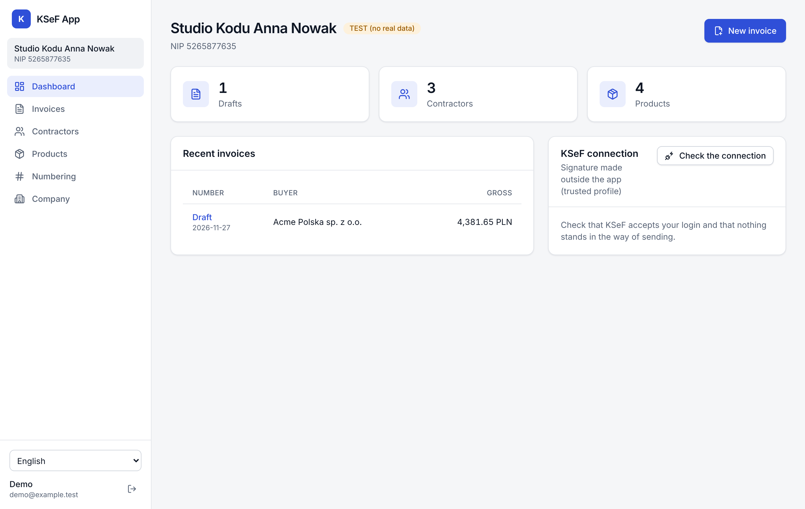
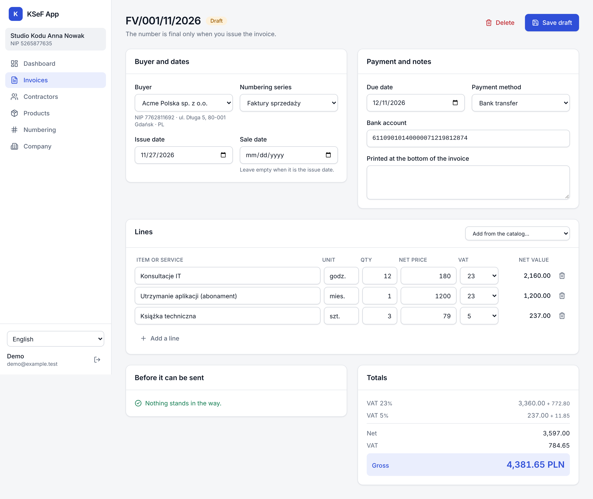
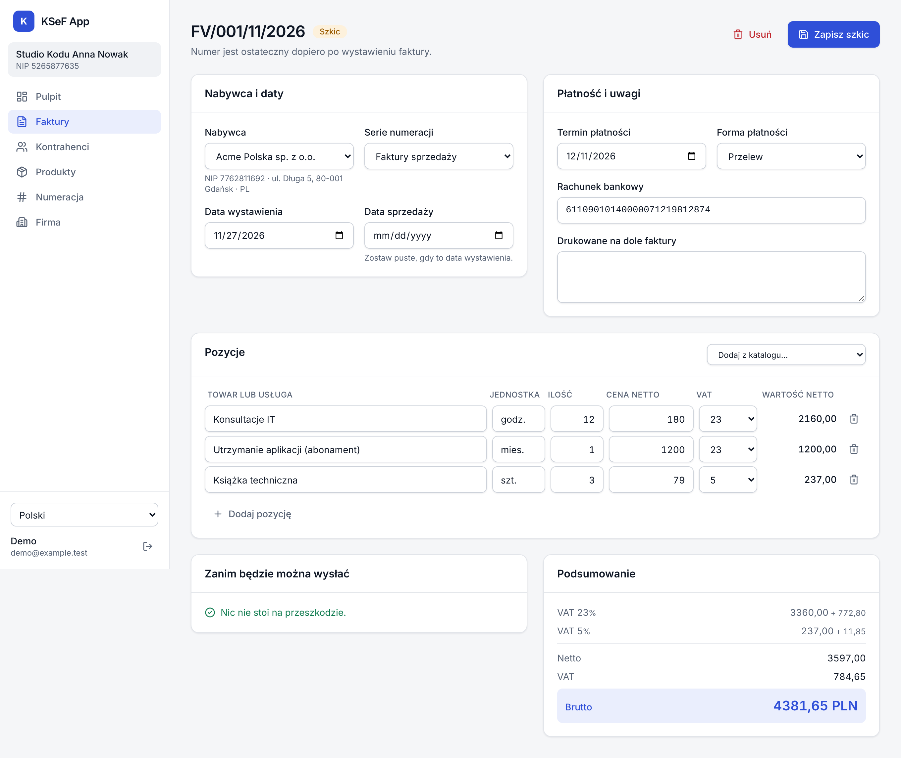
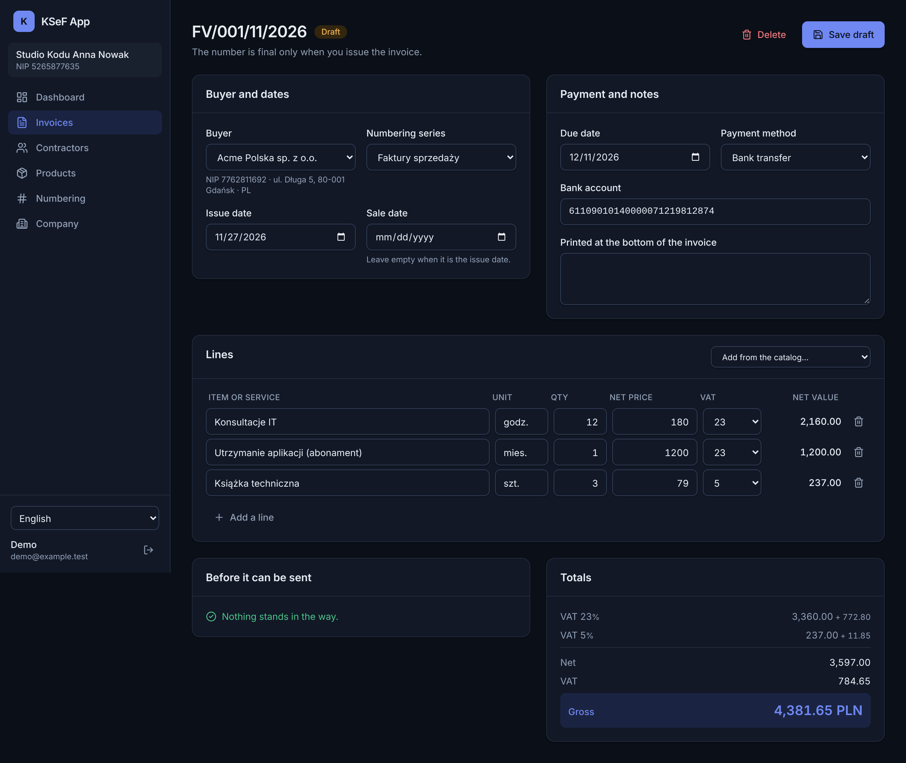
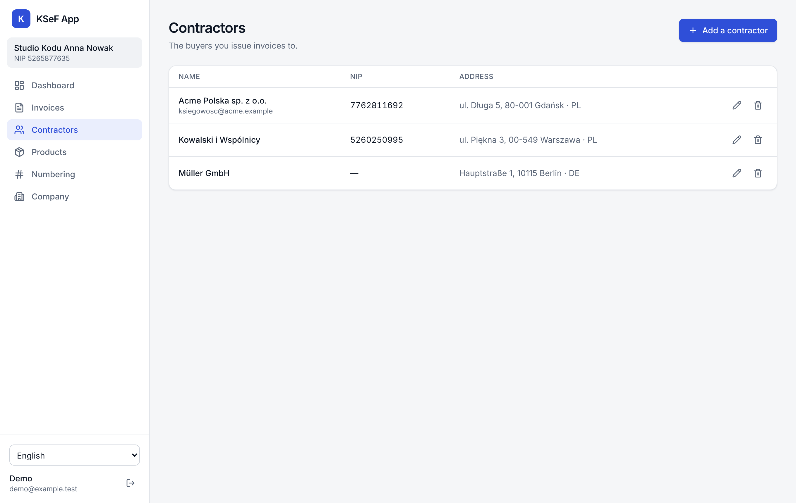
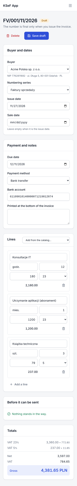

# ksef-app

A self-hosted application (and, later, a desktop app for Windows and macOS) for working with the Polish
**National e-Invoice System (KSeF)**: issue invoices, receive them, follow their status and keep the documents.

It is built on [`b44x/ksef-php`](https://github.com/b44x/ksef-php), the PHP SDK for KSeF API 2.0, so it speaks the
protocol the same way the SDK does: encryption, XAdES signing, schema validation, retries without duplicates.

> **Status: early development.** Nothing here is ready for production use yet. See the [roadmap](docs/ROADMAP.md).

## Screenshots

| Dashboard | Invoice draft |
| --- | --- |
|  |  |
| **Polish, same screen** | **Dark theme (follows the system)** |
|  |  |
| **Contractors** | **On a phone** |
|  |  |

The totals next to the lines are computed by the SDK as you type, never in the browser.

## What it will do

- **Connect** a company to KSeF with a token, a certificate or a signature made outside the app (trusted profile),
  and check the connection before anything is sent.
- **Issue** invoices (VAT, corrections, advance and settlement invoices), with contractors, products and numbering
  series; send them, follow their status, keep the UPO and print the QR code.
- **Receive** purchase invoices by synchronising from KSeF, browse and search them, download XML and PDF.
- **Stay safe when KSeF is down**: availability banner, offline invoices with their delivery deadline.
- **Run anywhere**: in a browser (Docker, a server, a NAS) first; as a desktop app for Windows and macOS from the same code.

Designed for one company per installation, with the data model ready for many companies.

## Stack

Laravel 13, Inertia with React and TypeScript, Tailwind, PHP 8.3+, SQLite by default (PostgreSQL optional), the KSeF SDK used directly.
Why this and not something else: [docs/ARCHITECTURE.md](docs/ARCHITECTURE.md).

## Try it

```bash
composer install && npm ci
cp .env.example .env && php artisan key:generate
php artisan migrate
npm run build
php artisan serve        # http://localhost:8000
```

To look around with example data (local use only; the login is `demo@example.test` / `demo-password-123`):

```bash
php artisan db:seed --class=DemoSeeder
```

Start on the KSeF **TEST** environment: it needs no real credentials and nothing you do there is real.

## Security

The app stores KSeF tokens and certificates. They are encrypted in the database with the application key
(`APP_KEY`: back it up, and never commit it), never written to logs, and never shown again after saving.
Run it behind HTTPS and keep the installation private to the people who work with your invoices.

## Disclaimer

This is a tool, not tax or accounting advice. Check invoices and the rules that apply to you with your accountant.

## License

MIT, see [LICENSE](LICENSE).
